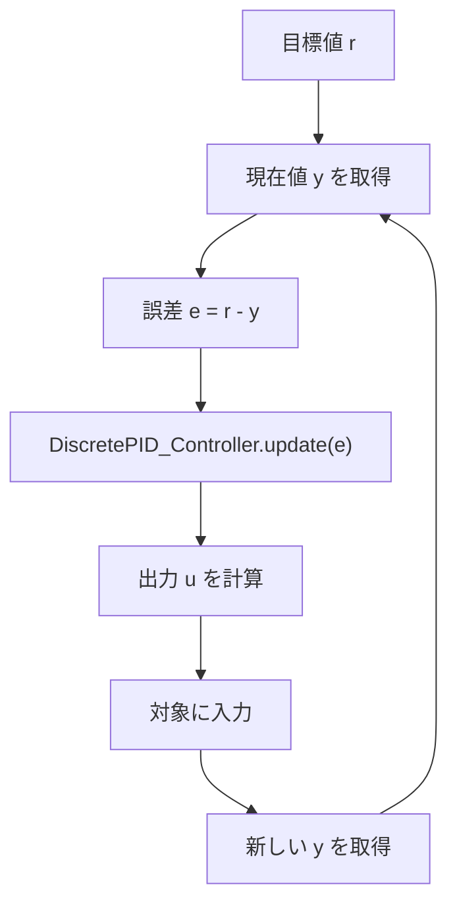

# PID 制御の使い方

`sample/pid_controller` では、`DiscretePID_Controller` を使って制御入力を逐次計算しています。
このクラスは「現在の誤差」から、比例・積分・微分の各項を加味して出力を返す役割を持ちます。

## 1. 典型的な使い方

`sample/pid_controller/discrete_pid_controller.py` では、次のような流れになります。

```python
from python_control.pid_controller import DiscretePID_Controller

pid = DiscretePID_Controller(
    delta_time=dt,
    Kp=Kp,
    Ki=Ki,
    Kd=Kd,
    N=(1.0 / dt),
    Kb=Ki,
    minimum_output=-0.2,
    maximum_output=0.2,
)

for i in range(len(time_series)):
    e = r - y
    u = pid.update(e)
```

ここで重要なのは、`error` を `update()` に渡すだけで、制御量 `u` を返してくれる点です。
サンプルでは、`r` が目標値、`y` が現在の状態で、`e = r - y` が誤差なので、これをそのまま PID に入れます。

## 2. 何を設定するべきか

### 必須パラメータ

- `delta_time`: 1ステップの時間幅
- `Kp`: 比例ゲイン
- `Ki`: 積分ゲイン
- `Kd`: 微分ゲイン

### 追加でよく使うパラメータ

- `N`: 微分項のフィルタ係数
- `Kb`: 積分ワインドアップ抑制用のバック計算係数
- `minimum_output`, `maximum_output`: 出力の上下限

`servo_motor_pid_control.py` では、モータの電圧を制限するために次のように設定しています。

```python
pid = DiscretePID_Controller(
    delta_time=sim_delta_time,
    Kp=Kp,
    Ki=Ki,
    Kd=Kd,
    N=(0.1 / sim_delta_time),
    Kb=Ki,
    minimum_output=-12.0,
    maximum_output=12.0,
)
```

この設定により、過大な制御入力を抑えて、安定した動作をしやすくなります。

## 3. 実際の制御ループ

PID 制御の流れは、サンプルコード上では次のように表せます。



## 4. reset() と内部状態

`reset()` を呼ぶと、積分項と微分項の内部状態をクリアできます。
これは、シミュレーションの開始時や制御モード切り替え時に、前の履歴を残したくない場合に使います。

```python
pid.reset()
```

## 5. 使うときのポイント

- 1ステップごとに `update(error)` を呼ぶのが基本です
- `error` は「目標 - 現在値」で定義するのが自然です
- 出力制限を設定すると、機械や電源の制約を守りやすくなります
- `Kb` を適切に設定すると、積分項が過剰に増えて制御が振動するのを防ぎやすくなります

これは `sample/pid_controller/servo_motor_pid_control.py` で見るように、モータの位置制御のようなループ制御に向いています。

次へ: [Kalman Filter の使い方](./03-kalman-filter.md)
