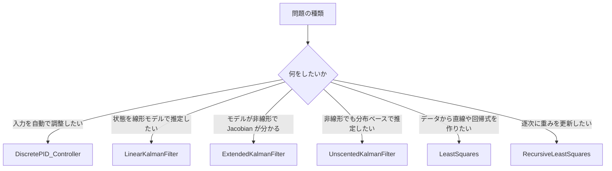

# Python Control 利用ガイド

このリポジトリの中核は、制御や状態推定の「使い方」を簡潔にしたクラス群です。
特に `sample/` フォルダにあるスクリプトは、各クラスを実際の制御や推定の流れで使う方法を示しています。

本ドキュメントでは、ユーザーがすぐに使い始められるように、以下の4つに分けて説明します。

- [概要と設計の考え方](./01-overview.md)
- [PID 制御の使い方](./02-pid-controller.md)
- [Kalman Filter の使い方](./03-kalman-filter.md)
- [最小二乗とオンライン推定の使い方](./04-estimation.md)

## このリポジトリでよく使うもの

- `DiscretePID_Controller`: ループ制御の実行器
- `LinearKalmanFilter`: 線形システムの状態推定
- `ExtendedKalmanFilter`: 非線形システムの状態推定
- `UnscentedKalmanFilter`: 非線形かつ高次のモデルに対する状態推定
- `LeastSquares`: バッチ処理の線形回帰
- `RecursiveLeastSquares`: 逐次更新の線形回帰

## どのクラスを選ぶべきか

## サンプルの位置

- `sample/pid_controller/discrete_pid_controller.py`
- `sample/pid_controller/servo_motor_pid_control.py`
- `sample/kalman_filter/linear_kalman_filter.py`
- `sample/kalman_filter/extended_kalman_filter.py`
- `sample/kalman_filter/unscented_kalman_filter.py`
- `sample/least_squares/least_squares_method.py`
- `sample/least_squares/recursive_squares_method.py`

実際の使い方は上記の各サンプルから確認できます。ドキュメントでは「クラスの使い方」に絞って、学習の入口をわかりやすく整理します。

## まず見るべき順番

1. [概要と設計の考え方](./01-overview.md)
2. [PID 制御の使い方](./02-pid-controller.md)
3. [Kalman Filter の使い方](./03-kalman-filter.md)
4. [最小二乗とオンライン推定の使い方](./04-estimation.md)

必要に応じて、各サンプルスクリプトを実行して、数値の変化と図の意味を見ながら理解すると、クラスの責務がより明確になります。
